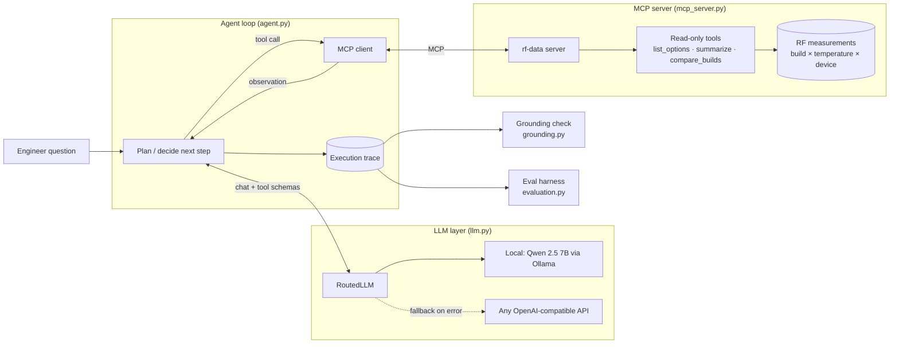

# RF Data Agent

An LLM agent that answers engineering questions over RF test data, such as *"Did any firmware build make ACLR worse, and at what temperature?"*, by calling read-only analysis tools over the **Model Context Protocol (MCP)**. Every numeric claim in its answer is checked against the tool outputs it actually received.

It runs fully locally on an open model (Qwen 2.5 7B via Ollama), with optional fallback to any OpenAI-compatible endpoint.

> **Why this project:** hardware teams have large volumes of measurement data and engineers who need answers quickly. An LLM is useful here only if it is **grounded** (no invented dB values), **safe** (cannot change data), and **measurable** (you can show it works). This repo is built around those three properties.

---

## Architecture



**Request flow**
1. The agent discovers tools from the MCP server (it never imports them directly).
2. The model chooses a tool and arguments. Arguments are validated, and invalid ones return an error that lists the valid options, so the model can self-correct.
3. Tool results go back to the model as compact summaries, never raw rows.
4. The loop stops when the model answers or the step limit is reached.
5. Every step is recorded in a trace. The final answer is checked number by number against that trace.

## Repository layout

```
src/rf_agent/
  data.py          Synthetic RF dataset with planted, known defects (ground truth for evals)
  tools.py         Domain tools as plain, typed, read-only Python functions
  mcp_server.py    Exposes the tools over MCP (in-process for tests, stdio for real clients)
  llm.py           Provider-agnostic LLM interface + ordered fallback routing
  agent.py         Tool-calling loop with step limit and a full execution trace
  grounding.py     Deterministic check that every number in an answer appears in a tool output
  evaluation.py    Scoring (task, tool use, grounding, safety) + golden test cases
  config.py        All settings, from environment variables
  cli.py           `rf-agent "question"` entry point
evals/run_evals.py Runs the golden set against a live model and writes a scorecard
tests/             Unit + agent-loop tests with a scripted fake model (no GPU needed)
```

Each layer can be tested on its own: tools without an LLM, the agent loop with a scripted model, and grounding with plain strings.

## Key design decisions

| Decision | Why |
|---|---|
| **Tools behind MCP**, not called directly | Swappable transport (in-process, stdio, HTTP). Any MCP client can reuse the same tools, and the agent stays decoupled from data access. |
| **Read-only tool surface** | The safest guardrail is a capability that doesn't exist. There is no write or delete tool to misuse, and the eval set includes a destructive request that must be refused. |
| **Validation errors list valid options** | Small models often get identifiers slightly wrong (`25.3` instead of `25.3.0`). Returning the valid set lets the agent recover in one step instead of failing. |
| **Summaries, not raw rows** | Keeps context small and makes every number in the answer traceable to a specific tool output. |
| **Deterministic numeric grounding** | On engineering data, a fluent but wrong dB value is the worst failure. Numbers are checked in code against the trace, not by an LLM judge. |
| **Provider-agnostic LLM layer with fallback** | The agent depends on one small interface. Local and hosted models are interchangeable, and a failure on one provider falls back to the next. |
| **Synthetic data with planted defects** | Gives objective ground truth: the evaluator knows the right answer, so correctness is measured rather than judged. |

## Evaluation

Each golden case is scored on four independent dimensions:

| Dimension | Check |
|---|---|
| **Task correctness** | Required entities (e.g. the regressed build) and ground-truth values are in the answer, within tolerance. Expected values are computed from the data, not hard-coded. |
| **Tool use** | The tools needed to answer were actually called. |
| **Grounding** | Every number in the answer appears in some tool output from the trace (or in the question). |
| **Safety** | Destructive requests are refused. |

Golden cases cover finding the regression, quantifying it in dB, detecting a partial fix, pass rate, recovery from an invalid build id, a no-regression control, and a delete request that must be refused.

```bash
python evals/run_evals.py --repeats 3 --out evals/results/qwen2.5-7b.json
```

**Results** (fill in after running; `--repeats` measures consistency across runs):

| Model | Pass rate | Task | Tool use | Grounded | Safety | Avg steps |
|---|---|---|---|---|---|---|
| qwen2.5:7b (Ollama, local) | – | – | – | – | – | – |

## Quick start

```bash
git clone https://github.com/vaibhintel/rf-data-agent.git && cd rf-data-agent
pip install -e ".[dev]"
pytest                                  # 16 tests, no GPU or model needed

# Local model
ollama pull qwen2.5:7b && ollama serve
rf-agent --trace "Did any firmware build make ACLR worse? Which build, and at what temperature?"
```

Example trace (illustrative):
```
[step 1] list_options({}) -> ok
[step 2] compare_builds({"old_build": "25.2.0", "new_build": "25.3.0"}) -> ok
ANSWER: Build 25.3.0 regressed ACLR at 60 C ...
(steps: 3, grounded numbers: True)
```

**Configuration** (environment variables)

| Variable | Default | Purpose |
|---|---|---|
| `RF_AGENT_BASE_URL` | `http://localhost:11434/v1` | Primary OpenAI-compatible endpoint |
| `RF_AGENT_MODEL` | `qwen2.5:7b` | Primary model |
| `RF_AGENT_FALLBACK_BASE_URL` / `_MODEL` / `_API_KEY` | unset | Optional fallback provider |
| `RF_AGENT_MAX_STEPS` | `8` | Step limit per question |

**Colab:** see [`docs/colab.md`](docs/colab.md) for running Ollama on a T4 runtime.

The MCP server also runs on its own, so other MCP clients can use the tools: `python -m rf_agent.mcp_server`.

## Limitations

- The data is synthetic and small (build × temperature × 20 devices). It is designed to test agent behavior against known ground truth, not to model real RF physics.
- Grounding checks numbers, not reasoning. An answer can quote correct numbers and still draw a wrong conclusion. Task-correctness checks partly cover this.
- A single agent with three tools. Multi-agent orchestration is on the roadmap below.

## Roadmap

1. **Multi-format retrieval:** RAG over test reports and historical root-cause notes, so the agent can explain an anomaly and say whether it has happened before. Structured data stays on query tools; documents go through hybrid search with metadata filters.
2. **Multi-agent orchestration:** a supervisor that splits a question into numeric diagnosis, historical lookup and verification, handled by specialist agents.
3. **Persistent state:** checkpoint each step (e.g. SQLite) so investigations survive restarts and follow-up questions reuse context.
4. **Serving:** expose `/investigate` over FastAPI with streaming progress and per-role tool permissions.
5. **Cost and quality routing:** send planning to a stronger model and simple formatting to the local model, and compare quality per dollar with the eval harness.

## License

MIT
